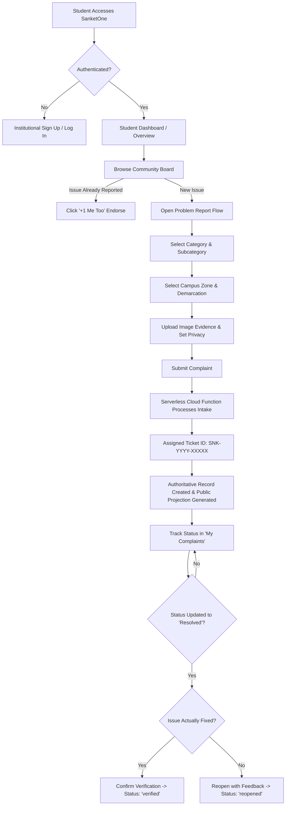
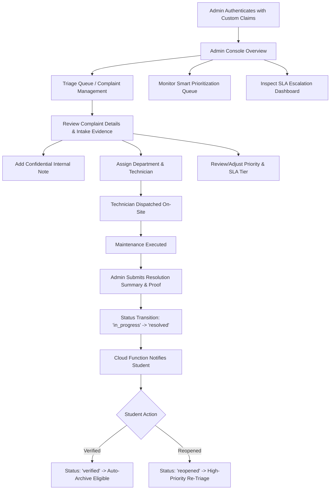
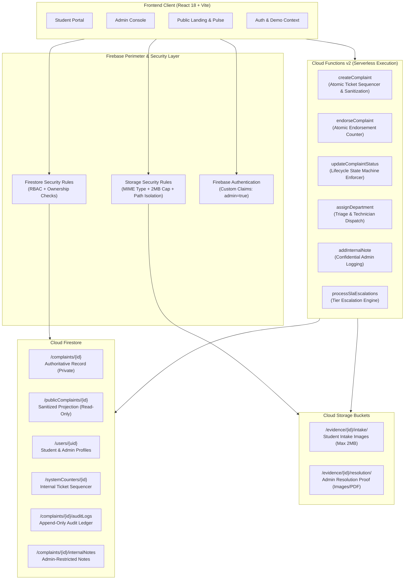

# SanketOne

> **One Signal. One Solution.**  
> *Intelligent Campus Complaint Management & Campus Intelligence Platform.*

---

## 1. Project Overview

**SanketOne** is a modern, enterprise-grade campus intelligence and grievance lifecycle platform designed for higher education institutions. Built on a resilient React 18, TypeScript, and Firebase serverless foundation, SanketOne streamlines how campus communities voice concerns, triage issues, track Service Level Agreements (SLAs), and coordinate facilities maintenance.

The platform bridges the communication gap between the student body and administrative staff by providing dual-role web portals, cryptographic PII protection, crowd-sourced duplicate prevention, and real-time operational analytics visualized through a high-performance Three.js digital signal canvas.

---

## 2. Problem Statement

Modern university campuses house thousands of students across extensive physical infrastructure. Traditional grievance processes suffer from critical systemic bottlenecks:

1. **Fragmented Channels**: Complaints arrive via informal emails, paper registers, WhatsApp groups, and verbal notices, leading to lost tickets and zero accountability.
2. **Duplicate Avalanche**: When a high-visibility incident occurs (e.g., a broken water cooler or Wi-Fi outage in an academic block), dozens of individual students file identical complaints, overwhelming maintenance dispatchers.
3. **Lack of SLA Transparency**: Students have no visibility into ticket status, resolution timelines, or escalation paths, breeding frustration and repeated follow-ups.
4. **Privacy Concerns**: Students often hesitate to report sensitive infrastructure or living-condition problems due to potential exposure of personal identification details.
5. **No Verification Loop**: Issues are frequently marked "Resolved" by contractors or administrators without independent confirmation from affected students.

---

## 3. Our Solution

SanketOne delivers a closed-loop, data-driven campus governance platform featuring:

- **Unified Single-Point Intake**: A structured problem reporting flow with pre-configured campus zones, subcategories, severity ratings, and strictly governed evidence uploads.
- **Crowd-Driven "+1 Me Too" Endorsements**: Enables students to upvote existing complaints rather than filing duplicates, dynamically raising urgency without multiplying support overhead.
- **Strict Separation of Authoritative Data and Public Projections**: Core tickets with complainant identity are locked in an administrative ledger (`/complaints`), while a serverless Cloud Function automatically generates sanitized, PII-scrubbed public records (`/publicComplaints`) for the campus community board.
- **Multi-Factor Smart Prioritization**: Combines category severity, affected student counts, community endorsements, and location sensitivity to compute dynamic triage rankings.
- **Automated 3-Tier SLA Escalations**: Enforces transparent resolution deadlines (T1 -> T2 -> T3) with breach detection and administrative alerts.
- **Student Verification & Reopen Loop**: Tickets marked resolved by maintenance must be confirmed by students, who can reopen tickets with feedback if the underlying problem persists.
- **Zero-Friction Demo Mode**: Seamless offline demonstration capability with instant persona switching alongside production Firebase Authentication and Firestore Security Rules.

---

## 4. Key Features

- **Role-Based Portals**:
  - **Student Portal**: Modern dashboard, streamlined problem submission wizard, personal complaint tracking with live status timelines, community discussion board, and campus pulse monitor.
  - **Admin Console**: Executive campus overview, triage ledger, technician dispatch, priority overrides, confidential internal notes, smart prioritization queue, and SLA escalation tracking.
- **3D Digital Signal Core**: Interactive Three.js particle canvas in the public hero section and campus pulse views, visually symbolizing campus communication signals.
- **Serverless Atomic Sequencer**: Cloud Function v2 orchestrates sequential ticket generation (`SNK-YYYY-XXXXX`) via atomic Firestore transactions, preventing ticket ID collisions.
- **Rigorous Evidence Governance**: Client-side image validation and compression paired with Firebase Storage security rules enforcing a 3-image quota, 2MB size cap, and strict MIME type enforcement (`image/jpeg`, `image/png`, `image/webp`).
- **Comprehensive Audit Trail**: Append-only administrative audit log subcollection capturing status transitions, priority overrides, department reassignments, and resolution submissions.

---

## 5. Unique Selling Propositions (USPs)

| USP | Architecture & Implementation | Benefit to Campus |
| :--- | :--- | :--- |
| **Dual-Mode Architecture** | Toggleable `VITE_DEMO_MODE` with pre-seeded personas and local state persistence alongside live Firebase Auth/Firestore/Storage. | Instant evaluation and testing without complex backend setup, while remaining 100% cloud-ready. |
| **Privacy-First Public Feed** | Isolated Firestore projection (`/publicComplaints`) synchronized exclusively via Cloud Functions; direct client writes forbidden. | Complete community transparency without ever leaking student PII, roll numbers, or contact info. |
| **Crowd Deduplication Engine** | Atomic subcollection-based "+1 Me Too" endorsements updating ticket counters. | Eliminates complaint redundancy and accurately measures campus-wide impact. |
| **Out-of-Band Admin Provisioning** | Admin role strictly guarded by Firebase Auth Custom Claims (`admin: true`), created only via administrative CLI tooling. | Eliminates client-side privilege escalation attack vectors entirely. |
| **Two-Way Closure Guarantee** | State machine enforces `resolved` -> `verified` or `reopened` transitions driven by student confirmation. | Ensures contractors and staff cannot prematurely close complaints without true resolution. |

---

## 6. Student Workflow



---

## 7. Admin Workflow



---

## 8. Technology Stack

### Frontend Application
- **Framework**: [React 18.3](https://react.dev/)
- **Language**: [TypeScript 5.6](https://www.typescriptlang.org/)
- **Bundler & Build Tool**: [Vite 6.0](https://vitejs.dev/)
- **Routing**: [React Router DOM 6.28](https://reactrouter.com/)
- **Styling**: [Tailwind CSS 3.4](https://tailwindcss.com/) with [PostCSS](https://postcss.org/) & [Autoprefixer](https://github.com/postcss/autoprefixer)
- **Utilities**: `clsx` and `tailwind-merge` for robust CSS class composition
- **Icons**: [Lucide React](https://lucide.dev/)
- **3D Visualizations**: [Three.js 0.187](https://threejs.org/)

### Backend, Serverless & Database
- **Client SDK**: [Firebase JS SDK 13.2](https://firebase.google.com/docs/web/setup) (Authentication, Cloud Firestore, Cloud Storage, Cloud Functions)
- **Serverless Functions**: [Firebase Functions v2](https://firebase.google.com/docs/functions) (Node.js 20 ESM)
- **Admin Management**: [Firebase Admin SDK 14.5](https://firebase.google.com/docs/admin/setup)
- **Local Emulation**: [Firebase Tools 15.34](https://firebase.google.com/docs/emulator-suite)

### Quality Assurance & Audit Tooling
- **Rules Unit Testing**: `@firebase/rules-unit-testing 6.0`
- **Visual Auditing**: `puppeteer-core 25.16`, `pixelmatch 8.0`, `pngjs 7.0`

---

## 9. System Architecture



---

## 10. Project Directory Structure

```
ps/
├── .env.example                       # Documented environment variable template
├── .firebaserc                        # Firebase target project mapping
├── .gitignore                         # Comprehensive ignore configuration
├── firebase.json                      # Firebase Emulators, Functions, and Rules config
├── firestore.indexes.json             # Composite query indexes for Firestore
├── firestore.rules                    # Authoritative security rules for Firestore
├── storage.rules                      # File type, size, and ownership rules for Storage
├── index.html                         # Vite application HTML entry point
├── package.json                       # Project manifests and lifecycle scripts
├── postcss.config.js                  # PostCSS plugins configuration
├── tailwind.config.js                 # Custom Tailwind theme and design tokens
├── tsconfig.json                      # Main TypeScript configuration
├── tsconfig.node.json                 # Node environment TypeScript configuration
├── vite.config.ts                     # Vite build and path alias configuration
│
├── functions/                         # Firebase Cloud Functions (v2)
│   ├── index.js                       # Serverless API endpoints & lifecycle logic
│   └── package.json                   # Functions dependencies (Node 20 ESM)
│
├── public/                            # Static web assets
│   ├── favicon.svg                    # Brand favicon
│   └── placeholders/                  # Placeholder fallbacks
│       └── fallback.svg
│
├── scripts/                           # Quality assurance, test suites & utilities
│   ├── provision-admin.mjs            # Out-of-band Admin provisioning utility
│   ├── test-auth-flows.mjs            # Firebase Auth & RBAC integration suite
│   ├── test-security-rules.mjs        # Firestore & Storage rules test suite
│   ├── test-step4-lifecycle.mjs       # Intake lifecycle & storage test suite
│   ├── test-step5-6-workflows.mjs     # Admin triage, SLA & endorsement test suite
│   ├── test-lifecycle.mjs             # End-to-end browser lifecycle test
│   ├── run-full-audit.mjs             # Comprehensive visual audit pipeline
│   ├── generate-diffs.mjs             # Image diff calculation utility
│   ├── compare-dom.mjs                # DOM structural verification tool
│   └── verify-*.mjs                   # Component & page verification scripts
│
├── src/                               # Frontend source code
│   ├── App.tsx                        # Root application shell & providers
│   ├── main.tsx                       # React DOM root render
│   ├── index.css                      # Global Tailwind directives & styling
│   ├── vite-env.d.ts                  # Vite environment variable definitions
│   │
│   ├── components/                    # Reusable React UI components
│   │   ├── common/                    # ErrorBoundary, NotificationsDrawer, etc.
│   │   ├── layout/                    # Admin/Student/Public Headers, Sidebars, Navbars
│   │   └── three/                     # Three.js 3D SignalCore canvas component
│   │
│   ├── context/                       # React Context providers
│   │   ├── AuthContext.tsx            # Live Firebase Auth + Demo Persona state
│   │   └── DemoDataContext.tsx        # In-memory reactive state for Demo Mode
│   │
│   ├── data/                          # Mock fixtures and constants
│   │   ├── mockSeedData.ts            # Realistic pre-seeded campus complaints
│   │   └── constants/                 # Campus zones, locations, categories
│   │       ├── categories.ts
│   │       └── locations.ts
│   │
│   ├── lib/                           # Core client services and utilities
│   │   ├── firebase.ts                # Firebase client initialization & emulator hook
│   │   ├── authService.ts             # Authentication wrappers & signup helpers
│   │   ├── complaintService.ts        # Client callable Cloud Function connectors
│   │   └── utils.ts                   # Class merge (cn), formatting & validation
│   │
│   ├── pages/                         # Application views and routes
│   │   ├── admin/                     # Overview, Complaints, Prioritization, SLA, etc.
│   │   ├── auth/                      # Login, Registration, Password Reset
│   │   ├── public/                    # Landing, About, How It Works
│   │   ├── student/                   # Dashboard, Report, My Complaints, Community, Pulse
│   │   └── system/                    # NotFound (404), Unauthorized (403)
│   │
│   ├── routes/                        # Client routing configuration
│   │   ├── AppRoutes.tsx              # Application route tree
│   │   └── ProtectedRoute.tsx         # Role-based route guard
│   │
│   └── types/                         # TypeScript domain models
│       ├── complaint.ts               # Complaint, evidence, audit log interfaces
│       ├── demoData.ts                # Demo state shape interfaces
│       ├── firestore.ts               # Database document structures
│       └── user.ts                    # UserProfile, DemoUser, and Role types
│
├── visual_audit/                      # Visual regression metrics and test outputs
├── screenshots/                       # Captured audit screenshots
└── *.html                             # Original Stitch design reference exports
```

---

## 11. Installation Instructions

### Prerequisites
- **Node.js**: Version `20.x` or later (LTS recommended)
- **npm**: Version `10.x` or later
- **Java Runtime Environment (JRE)**: Version 11 or later (required by Firebase Emulator Suite)

### Setup Steps

1. **Clone the repository**:
   ```bash
   git clone <repository-url>
   cd ps
   ```

2. **Install root dependencies**:
   ```bash
   npm install
   ```

3. **Install Cloud Functions dependencies**:
   ```bash
   cd functions
   npm install
   cd ..
   ```

---

## 12. Environment Variable Setup

Copy the example environment configuration into your local environment file:

```bash
cp .env.example .env
```

### Environment Variables Reference

| Variable | Type | Description | Default / Example |
| :--- | :--- | :--- | :--- |
| `VITE_APP_ENV` | `string` | Current runtime mode (`development`, `production`, `test`) | `development` |
| `VITE_DEMO_MODE` | `boolean` | Enables standalone demo mode with instant persona switching | `false` |
| `VITE_ALLOWED_STUDENT_EMAIL_DOMAINS` | `string` | Allowed student email domain pattern (`*` allows all) | `*` |
| `VITE_MAX_EVIDENCE_FILES` | `number` | Maximum allowed intake evidence uploads per complaint | `3` |
| `VITE_MAX_IMAGE_SIZE_MB` | `number` | Maximum image size in Megabytes | `2` |
| `VITE_FIREBASE_API_KEY` | `string` | Firebase Web API key | *Project API Key* |
| `VITE_FIREBASE_AUTH_DOMAIN` | `string` | Firebase Authentication domain | `sanketone.firebaseapp.com` |
| `VITE_FIREBASE_PROJECT_ID` | `string` | Firebase project identifier | `sanketone` |
| `VITE_FIREBASE_STORAGE_BUCKET` | `string` | Firebase Storage bucket URI | `sanketone.firebasestorage.app` |
| `VITE_FIREBASE_MESSAGING_SENDER_ID` | `string` | Firebase Cloud Messaging sender ID | `689142996129` |
| `VITE_FIREBASE_APP_ID` | `string` | Firebase Web Application ID | `1:689142996129:web:...` |
| `VITE_USE_FIREBASE_EMULATORS` | `boolean` | Connects client SDKs to local emulator hosts | `false` (set `true` for emulators) |
| `VITE_FIREBASE_AUTH_EMULATOR_HOST` | `string` | Auth emulator host and port | `localhost:9099` |
| `VITE_FIRESTORE_EMULATOR_HOST` | `string` | Firestore emulator host and port | `localhost:8080` |
| `VITE_FIREBASE_STORAGE_EMULATOR_HOST` | `string` | Storage emulator host and port | `localhost:9199` |
| `VITE_FIREBASE_FUNCTIONS_EMULATOR_HOST` | `string` | Functions emulator host and port | `localhost:5001` |

---

## 13. Firebase Project Configuration

SanketOne requires the following Firebase products enabled in the Firebase Console:

1. **Authentication**:
   - Provider: **Email/Password** enabled.
2. **Cloud Firestore**:
   - Mode: Production mode (rules deployed from `firestore.rules`).
3. **Cloud Storage**:
   - Storage bucket initialized with rules deployed from `storage.rules`.
4. **Cloud Functions**:
   - Node.js 20 runtime (v2 functions enabled).

Deploying security rules and functions directly:
```bash
# Login to Firebase
npx firebase login

# Select or switch to your Firebase project
npx firebase use sanketone

# Deploy Firestore rules and composite indexes
npx firebase deploy --only firestore

# Deploy Storage security rules
npx firebase deploy --only storage

# Deploy Cloud Functions
npx firebase deploy --only functions
```

---

## 14. Firebase Emulator Suite Setup

For local offline development and testing, SanketOne is fully configured with the Firebase Local Emulator Suite.

### Starting the Emulators
```bash
npx firebase emulators:start --only auth,firestore,storage,functions
```

### Emulator Port Allocations (Defined in `firebase.json`):
- **Auth Emulator**: `localhost:9099`
- **Firestore Emulator**: `localhost:8080`
- **Storage Emulator**: `localhost:9199`
- **Functions Emulator**: `localhost:5001`
- **Emulator UI Suite**: `localhost:4000`

To point the frontend to the emulators, ensure `.env` contains:
```env
VITE_USE_FIREBASE_EMULATORS=true
```

---

## 15. Local Development Commands

```bash
# Start the Vite development server (default: http://localhost:5173)
npm run dev

# Start development server and emulators simultaneously (separate terminal)
npx firebase emulators:start

# Run TypeScript typecheck without emitting output
npm run typecheck

# Preview a production build locally
npm run preview
```

---

## 16. Testing Commands

SanketOne includes specialized test suites covering authentication, security rules, and end-to-end workflows:

```bash
# 1. Test Firestore and Storage Security Rules
# Connects to Firestore emulator and executes rule assertions
npm run test:rules

# 2. Test Firebase Authentication & RBAC Flows
# Tests student registration, domain validation, and custom claims verification
npm run test:auth

# 3. Test Step 4 Intake Lifecycle & Storage Quotas
# Verifies atomic ticket allocation, idempotent submissions, and storage rules
npm run test:complaints

# 4. Test Step 5 & 6 Admin Workflows & Endorsement Workflows
# Tests triage, department assignment, SLA escalation, and +1 Me Too endorsements
npm run test:workflows

# 5. Out-of-band Administrator Account Provisioning
# Creates an administrative user with custom claims on the target project/emulator
npm run provision:admin -- --email="dean.affairs@campus.edu" --password="AdminPassword123!" --name="Dr. Sunita Menon"
```

---

## 17. Production Build Instructions

To build the client application for production:

```bash
npm run build
```

This script performs:
1. `tsc` — Strict TypeScript typecheck across all project files.
2. `vite build` — Asset minification, code-splitting, PostCSS processing, and bundling into the `dist/` directory.

---

## 18. Deployment Instructions

### Frontend Hosting
The output `dist/` directory can be deployed to any modern static hosting provider:

- **Firebase Hosting**:
  ```bash
  npx firebase deploy --only hosting
  ```
- **Vercel / Netlify**: Configure root build command `npm run build` and output directory `dist`.

### Backend Functions & Rules
Deploy backend resources atomically:
```bash
npx firebase deploy --only functions,firestore,storage
```

---

## 19. Security Architecture

```mermaid
flowchart TD
    subgraph ClientPerimeter["Client Perimeter"]
        REQ[Client Request]
        INPUT_VAL[Client-Side File & Field Validation]
    end

    subgraph FirebaseRules["Authoritative Security Gateways"]
        FS_RULE{"Firestore Security Rules\nisAuthenticated() & isAdmin() / isOwner()"}
        ST_RULE{"Storage Security Rules\nContent-Type, File Size <= 2MB, Path Regex"}
    end

    subgraph ServerlessSecurity["Cloud Functions Security Sandbox"]
        AUTH_CHECK[Identity Verification: auth.uid == request.studentId]
        SEVERITY_CHECK[Allowed Categories & Field Length Validation]
        ATOMIC_TX[Atomic Firestore Transaction]
    end

    subgraph DataStorage["Authoritative Storage"]
        AUTH_DOC[Private Ledger: /complaints/{id}]
        PUBLIC_DOC[Sanitized Public Feed: /publicComplaints/{id}]
        AUDIT_REC[Append-Only Audit Record]
    end

    REQ --> INPUT_VAL
    INPUT_VAL -->|Direct Read/Write| FS_RULE
    INPUT_VAL -->|Evidence Upload| ST_RULE
    INPUT_VAL -->|Callable Functions| AUTH_CHECK

    AUTH_CHECK --> SEVERITY_CHECK --> ATOMIC_TX
    ATOMIC_TX --> AUTH_DOC
    ATOMIC_TX --> PUBLIC_DOC
    ATOMIC_TX --> AUDIT_REC
```

### Core Security Tenets:
1. **Zero Client Trust**:
   - Ticket numbers (`SNK-YYYY-XXXXX`) are computed server-side via transaction; client submissions cannot inject or forge ticket IDs.
   - Public complaint projection (`/publicComplaints`) strictly forbids direct client writes (`allow write: if false;`).
2. **Strict Custom Claims RBAC**:
   - Admin routes and operations require `request.auth.token.role == 'admin'` or `request.auth.token.admin == true`.
   - User profile documents (`/users/{uid}`) prevent self-elevation of roles.
3. **Internal Notes Confidentiality**:
   - The `/complaints/{id}/internalNotes` subcollection is strictly locked to administrative accounts. Students have zero read/write access.
4. **Evidence Quota Enforcement**:
   - Storage security rules restrict file size to $\le 2\text{ MB}$, allow only `image/jpeg`, `image/png`, and `image/webp`, and enforce path isolation by uploader UID.

---

## 20. Demo Mode Instructions

SanketOne includes a zero-configuration Demo Mode designed for evaluations, walkthroughs, and UI demonstrations without requiring live Firebase credentials.

### Enabling Demo Mode:
In your `.env` file, set:
```env
VITE_DEMO_MODE=true
```

### Pre-Configured Demo Personas:
1. **Student Persona**:
   - **Name**: Aditi Sharma
   - **Identity**: Computer Science & Engineering • Sem 6 (`#22BCS041`)
   - **Email**: `aditi.sharma@campus.edu`
   - **Hostel**: Hostel Block IV (Mahanadi)
2. **Admin Persona**:
   - **Name**: Dr. Sunita Menon
   - **Title**: Dean of Student Affairs / Chief Custodian
   - **Email**: `dean.affairs@campus.edu`
   - **Department**: Deanery

### Persona Switching:
When `VITE_DEMO_MODE=true`, a **Demo Persona Switcher** widget appears in the top navigation bar. Click **Switch to Admin** or **Switch to Student** to instantly switch roles, view authorized routes, and test role-specific workflows with local state persistence.

---

## 21. Current Implementation Status

| Component / Subsystem | Implementation Status | Notes |
| :--- | :---: | :--- |
| **Public Landing & Information Pages** | Complete | Landing, About, and How-It-Works pages styled with Tailwind. |
| **Interactive 3D Signal Core** | Complete | Three.js particle canvas rendered in hero and campus pulse views. |
| **Authentication & RBAC** | Complete | Firebase Auth + Custom Claims + Demo Mode persona switcher. |
| **Student Portal Pages** | Complete | Dashboard, Problem Report, My Complaints, Community Board, Pulse. |
| **Admin Console Pages** | Complete | Campus Overview, Complaint Management, Prioritization, SLA, Departments. |
| **Serverless Cloud Functions** | Complete | Callable functions v2 for intake, endorsements, status, triage, and SLA. |
| **Firestore Security Rules** | Complete | Comprehensive rules covering users, complaints, projections, and audit logs. |
| **Storage Security Rules** | Complete | Strict validation for intake images (2MB limit) and resolution documents. |
| **Automated Test Suites** | Complete | Auth flows, security rules, and complaint lifecycle verification scripts. |
| **Visual Audit Pipeline** | Complete | Multi-viewport Puppeteer screenshot captures and pixelmatch diffing. |

---

## 22. Known Limitations

- **Audio/Voice Evidence**: Voice memo attachments are currently deferred in MVP; only image evidence (`JPG`, `PNG`, `WebP`) is accepted.
- **Geographic Map Rendering**: GPS coordinates are recorded in the schema (`geoLat`, `geoLng`, `geotag`), but an interactive tile map (e.g., Leaflet/Mapbox) is reserved for future versions.
- **Push Notifications**: In-app notifications are surfaced through the `NotificationsDrawer` component; native Web Push (FCM Service Worker) integration is planned for subsequent releases.

---

## 23. Future Scope

1. **AI-Powered Semantic Duplicate Detection**: Real-time vector embedding analysis using Gemini API to identify similar complaints during intake typing before submission.
2. **Automated Contractor SLA Dispatch**: Integration with campus ERP systems for automated SMS/WhatsApp alerts to maintenance contractors upon ticket assignment.
3. **Interactive Campus Heatmap**: Dynamic 2.5D building floor plan visualization showing real-time grievance concentrations.
4. **Multilingual Support**: Localization into regional languages for campus housekeeping and support staff.

---

## 24. Contributors

- **Project Lead & Architecture**: *Contributors / SanketOne Engineering Team*
- **Frontend & UI/UX Engineering**: *Contributors / SanketOne Engineering Team*
- **Cloud Infrastructure & Security**: *Contributors / SanketOne Engineering Team*

---

*© 2026 SanketOne. One Signal. One Solution. All rights reserved.*
